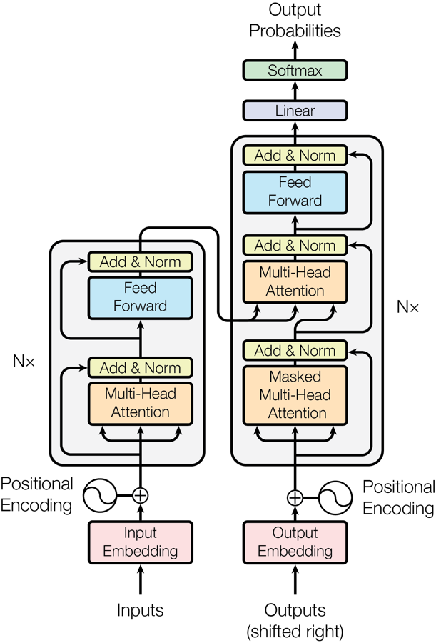

## Overview

<!-- Alan's summary goes here -->

A forward pass is one run of the model: token vectors go in, a score for every word in the vocabulary comes out. [Model Weights](/posts/model-weights/) showed which matrices are in the file; this post follows the numbers through them.

## The Steps

| Step | What it does (stored weights in `code`) |
|---|---|
| 1. Look up | copy each token's row out of `embed_tokens` |
| 2. Normalize | scale each token's x to about the same size, times `input_layernorm` |
| 3. Q, K, V | multiply the normalized x by `q_proj`, `k_proj` and `v_proj` |
| 4. Attention | score Q against every earlier K, softmax into shares, mix the V's into A (no stored weights) |
| 5. o_proj | O = A × `o_proj`, then add back: x + O |
| 6. Normalize | same as step 2, with `post_attention_`<br>`layernorm` |
| 7. Feed-forward | widen with `up_proj`, ReLU, shrink back with `down_proj` to F, then add back: x + F |
| 8. Next word | normalize once more with `norm`, × `lm_head` gives one score per word, softmax |

Steps 2 to 7 are one layer. Llama-3-8B repeats them 32 times, each layer with its own weights.

## Two Paths: Normalize and Add Back

Attention and the feed-forward each get a normalized copy of x, but their result is added to the original x:

```text
      ┌─→ normalize → x̂ → attention → O ─┐
x ────┤                                   ├─→ x + O
      └───────────── x (unchanged) ───────┘
```

x is the main path through the whole model, and each block only adds to it. Keeping x unnormalized keeps what earlier layers built up, and gives training a straight path back to layer 0. Normalizing before each block (not after) is called **pre-norm**.

## The Transformer Diagram

This is the architecture figure from the 2017 paper. Llama keeps only the right column (the decoder). Read bottom to top, its boxes are [The Steps](#the-steps) above: embedding, attention, add & norm, feed-forward, then Linear (`lm_head`) and softmax.

<div class="paper-split">
<figure class="paper-fig">

<figcaption>Figure 1 of Vaswani et al., <a href="https://arxiv.org/abs/1706.03762"><em>Attention Is All You Need</em></a> (2017). Reproduced with attribution, as the paper permits for scholarly use.</figcaption>
</figure>
<div class="paper-notes">

**Why only the right column?** The paper was built for translation: the encoder (left) reads the whole source sentence, and the decoder (right) writes the translation while looking at it through the middle attention box. In chat, the prompt and the answer are one text, start and continuation. The decoder reads the prompt (prefill) and keeps writing (decode) by itself, so the encoder and the middle box are dropped.

**What is Multi-Head?** Q, K and V are cut into several equal parts called heads. Each head runs its own attention, with its own score table, so different heads can follow different things. The heads' results are joined end to end, and `o_proj` mixes them. Llama-3-8B has 32 heads of 128 numbers. The Multi-Head demo at the end of [Demo](#demo) shows 2.

**What is Masked?** A token can only look at itself and earlier tokens: the "·" cells in the demo's score table.

**What is N×?** The same layer, stacked N times, each with its own weights.

</div>
</div>

Besides dropping the encoder, Llama changes four things:

1. **Pre-norm.** The figure adds, then normalizes (post-norm); Llama normalizes first (see [Two Paths](#two-paths-normalize-and-add-back)).
2. **RMSNorm instead of LayerNorm.** LayerNorm subtracts the mean and divides by the standard deviation; RMSNorm only divides by the RMS, which is cheaper and works about as well.
3. **SwiGLU instead of ReLU** in the feed-forward (the demo keeps ReLU).
4. **RoPE instead of Positional Encoding.** The figure adds position to the input; Llama rotates Q and K by position inside attention (not in the demo).

## Why the Formulas Look Like This

- **RMSNorm: x ÷ RMS(x) × w.** RMS is the root mean square: square each number (so negatives do not cancel), take the mean, take the square root. It is the numbers' typical size, one per token, computed on the spot. Dividing by it makes the typical size 1; single numbers can still be above or below 1. w is stored, one number per dimension, and every norm has its own w (32 × 2 + 1 = 65 in Llama-3-8B).
- **Divide scores by √d.** A dot product adds up d terms, so scores grow with d. Big scores make softmax give almost 100% to one token, and the model learns poorly. The dot product grows roughly with √d, so dividing by √d keeps scores in range.
- **e to the power in softmax.** Scores can be negative, and dividing by the total would give negative shares. e to the power turns every score positive and keeps the order; dividing by the total makes the shares add up to 100%.

## Prefill and Decode

In **prefill**, all prompt tokens go through these steps together, and only the last position's scores pick the first new token. In **decode**, only the new token goes through; at step 4 it reads the earlier tokens' K and V from the KV cache. See [Prefill and Decode](/posts/prefill-and-decode/).

## Q&A

**Q: Why do RMSNorm and softmax both divide by something?**

A: For different reasons. RMSNorm divides each token's vector by its own size, so every layer gets inputs of a steady size. Softmax divides by the total so the shares add up to 100%.

## Demo

The tiny model from [Model Weights](/posts/model-weights/), run on "I like cats". Every step names the stored tensor it uses and writes out the arithmetic.

Scaled down: 4 numbers per vector instead of 4,096, 2 layers instead of 32, one attention head, ReLU instead of SwiGLU. Weights are made up, not trained.

<div class="qkv-demo pf-demo mw-demo" data-mw-forward></div>

### Multi-Head

The same layer-0 Q, K and V as the demo above, run as 1 head and as 2 heads. Switch between them and compare the shares.

<div class="qkv-demo pf-demo mw-demo mh-demo" data-mh-demo></div>

<script src="/assets/notes/tiny-llama.js" defer></script>
<script src="/assets/notes/model-weights-forward-demo.js" defer></script>
<script src="/assets/notes/multi-head-demo.js" defer></script>
