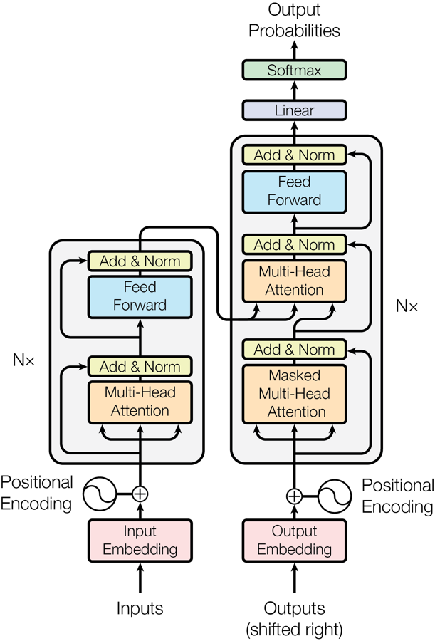

## 概览

<!-- Alan's summary goes here -->

一次前向计算（forward pass）就是把模型完整跑一遍：输入每个 token 的向量，输出词表里每个词的分数。[Model Weights](/posts/model-weights/zh/) 讲了文件里有哪些矩阵，这篇跟着数字走一遍这些矩阵。

## 步骤

| 步骤 | 做什么（`代码字体` 是存储的权重） |
|---|---|
| 1. 查表 | 从 `embed_tokens` 里复制出每个 token 那一行 |
| 2. 归一化 | 把每个 token 的 x 缩放到差不多的大小，再乘 `input_layernorm` |
| 3. Q、K、V | 归一化后的 x 分别乘 `q_proj`、`k_proj`、`v_proj` |
| 4. Attention | Q 跟前面每个 K 打分，softmax 变成比例，按比例混合 V 得到 A（不用存储的权重） |
| 5. o_proj | O = A × `o_proj`，再加回去：x + O |
| 6. 归一化 | 跟第 2 步一样，用 `post_attention_`<br>`layernorm` |
| 7. Feed-forward | 用 `up_proj` 变宽、ReLU、用 `down_proj` 缩回 F，再加回去：x + F |
| 8. 下一个词 | 用 `norm` 再归一化一次，× `lm_head` 得到每个词一个分数，softmax |

第 2～7 步是一层。Llama-3-8B 把它们重复 32 遍，每层用自己的权重。

## 两条路：归一化和加回去

attention 和 feed-forward 拿到的都是 x 归一化后的副本，但它们的结果加到原来的 x 上：

```text
      ┌─→ 归一化 → x̂ → attention → O ─┐
x ────┤                                ├─→ x + O
      └──────────── x（原样）──────────┘
```

x 是贯穿整个模型的主干，每一块只是往上加东西。主干不归一化，前面层积累的信息就不会被抹掉，训练时梯度也有一条直通第 0 层的路。先归一化再进每一块（而不是之后），叫 **pre-norm**。

## 对照 Transformer 原图

这是 2017 年论文里的架构图。Llama 只保留右边那一列（decoder）。从下往上读，就是上面[步骤](#步骤)表的顺序：embedding、attention、加回去并归一化、feed-forward，最后 Linear（`lm_head`）和 softmax。

<div class="paper-split">
<figure class="paper-fig">

<figcaption>出自 Vaswani et al., <a href="https://arxiv.org/abs/1706.03762"><em>Attention Is All You Need</em></a>（2017）的 Figure 1。按论文的授权，注明出处后用于学术用途。</figcaption>
</figure>
<div class="paper-notes">

**为什么只有右边一列？** 论文是为翻译设计的：encoder（左边）读完整句原文，decoder（右边）一边写译文，一边通过中间那个 attention 去查原文。聊天时，prompt 和回答是同一段文字的开头和后续。decoder 自己就能读完 prompt（prefill）再接着往下写（decode），所以 encoder 和中间那个方框都不要了。

**Multi-Head 是什么？** 把 Q、K、V 各切成几等份，每一份叫一个 head。每个 head 各自做一遍 attention，有自己的分数表，所以不同的 head 可以关注不同的东西。各个 head 的结果首尾拼起来，再由 `o_proj` 混合。Llama-3-8B 有 32 个 head，每个 128 维。[Demo](#demo) 最后的 Multi-Head demo 演示 2 个。

**Masked 是什么？** 每个 token 只能看自己和前面的 token，就是 demo 分数表里的「·」。

**N× 是什么？** 同一种层叠 N 次，每层有自己的权重。

</div>
</div>

除了去掉 encoder，Llama 还改了四处：

1. **Pre-norm。** 原图是先加再归一化（post-norm）；Llama 先归一化（见[两条路](#两条路-归一化和加回去)）。
2. **用 RMSNorm 代替 LayerNorm。** LayerNorm 先减均值再除以标准差；RMSNorm 只除以 RMS，算得更快，效果差不多。
3. feed-forward **用 SwiGLU 代替 ReLU**（demo 里还是 ReLU）。
4. **用 RoPE 代替 Positional Encoding。** 原图把位置加到输入上；Llama 在 attention 里按位置旋转 Q 和 K（demo 里没有）。

## 公式为什么长这样

- **RMSNorm：x ÷ RMS(x) × w。** RMS 是 root mean square（均方根）：先平方（这样负数不会跟正数抵消），求平均，再开根号。它是这组数的「典型大小」，每个 token 一个，现场算出来。除以它，典型大小就变成 1；单个数仍然可以大于或小于 1。w 存在文件里，每个维度一个数，而且每个 norm 都有自己的一组 w（Llama-3-8B 里一共 32 × 2 + 1 = 65 组）。
- **分数除以 √d。** 点积要把 d 项加起来，所以 d 越大分数越大。分数太大，softmax 会几乎 100% 给一个 token，模型也很难学。点积大约跟 √d 成正比，除以 √d 就把分数拉回差不多的范围。
- **softmax 里取 e 的次方。** 分数可能是负数，直接除以总和会得到负的比例。e 的次方把每个分数都变成正数，而且顺序不变；再除以总和，比例加起来就是 100%。

## Prefill 和 Decode

**Prefill** 时，所有 prompt token 一起走这些步骤，只用最后一个位置的分数挑出第一个新 token。**Decode** 时，只有新 token 走这些步骤；到第 4 步，它从 KV cache 里读前面 token 的 K 和 V。见 [Prefill and Decode](/posts/prefill-and-decode/zh/)。

## Q&A

**Q：RMSNorm 和 softmax 都在做除法，有什么区别？**

A：目的不同。RMSNorm 用每个 token 自己的大小去除它，让每一层拿到的输入大小稳定。softmax 除以总和，是为了让比例加起来等于 100%。

## Demo

[Model Weights](/posts/model-weights/zh/) 里的那个小模型，拿 "I like cats" 跑一遍。每一步都写出用到的权重，并把算式写出来。

缩小版：每个向量 4 个数（真实是 4,096），2 层（真实是 32 层），1 个 attention head，用 ReLU 代替 SwiGLU。权重是编出来的，不是训练出来的。

<div class="qkv-demo pf-demo mw-demo" data-mw-forward></div>

### Multi-Head（多头）

跟上面 demo 第 0 层同样的 Q、K、V，分别按 1 个 head 和 2 个 head 来算。切换看看两种情况的比例有什么不同。

<div class="qkv-demo pf-demo mw-demo mh-demo" data-mh-demo></div>

<script src="/assets/notes/tiny-llama.js" defer></script>
<script src="/assets/notes/model-weights-forward-demo.js" defer></script>
<script src="/assets/notes/multi-head-demo.js" defer></script>
