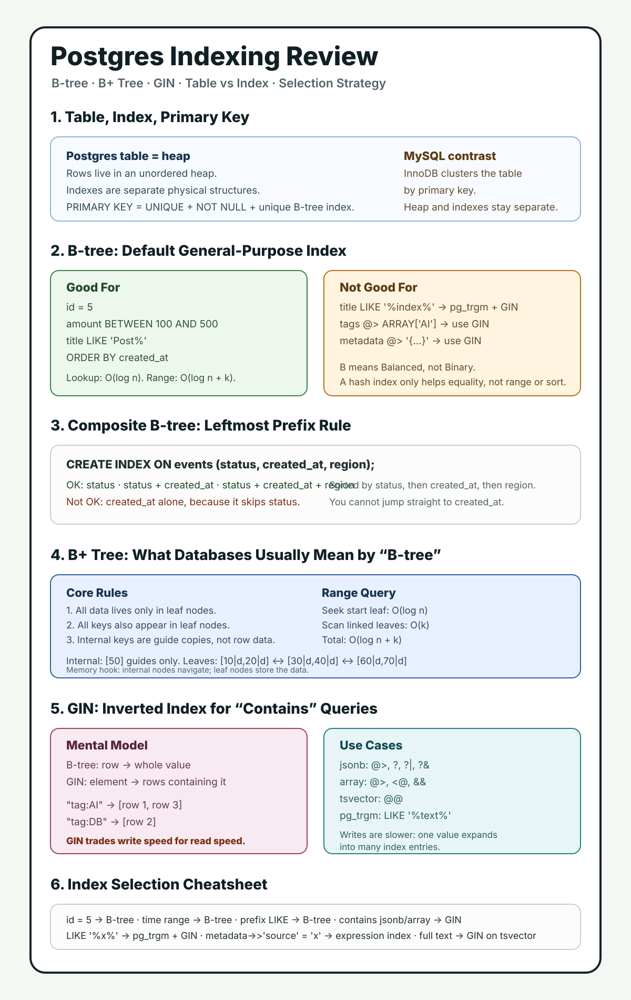

This is a review note for Postgres indexing. It covers B-tree, B+ tree, GIN, table/index storage, primary keys, jsonb operators, index selection, SQL syntax, trade-offs, and common interview traps.



## Part 1. Table vs Index vs Primary Key

| Concept | Meaning | Physical implementation in Postgres |
|---|---|---|
| Table | Logical container for rows | Heap: unordered row storage |
| Index | Extra data structure that speeds up queries | Stored separately from the table, such as B-tree or GIN |
| Primary Key | Uniqueness plus not-null constraint | Automatically creates a unique B-tree index |

Key facts:

- A table does not technically need a primary key, but production tables usually should have one.
- One table can have many indexes, and the index types can be different.
- In Postgres, the table heap and indexes are separate physical structures.
- In MySQL InnoDB, the primary key index is the clustered table storage. This is a major difference.

中文记忆：

```text
Postgres: 表是 Heap，索引是额外结构。
MySQL InnoDB: 主键索引就是聚簇表本身。
```

Primary key syntax sugar:

```sql
CREATE TABLE users (
  userid bigint PRIMARY KEY,
  name text
);

-- Conceptually similar to:
CREATE TABLE users (
  userid bigint NOT NULL,
  name text
);

ALTER TABLE users
ADD CONSTRAINT users_pkey PRIMARY KEY (userid);

-- Database automatically creates:
CREATE UNIQUE INDEX users_pkey ON users (userid);
```

## Part 2. B-tree Index

`B` does not mean `Binary`. The inventors never said what it stands for; Balanced, Bayer, and Boeing are common guesses.

A B-tree index is the default Postgres index type. It is a self-balancing multi-way search tree, designed to keep lookup depth small.

| Operation | Complexity | Compared with |
|---|---|---|
| Lookup | `O(log n)` | Sequential scan is `O(n)` |
| Insert/delete | `O(log n)` | Index maintenance cost is paid on writes |
| Range query | `O(log n + k)` | `k` is the number of matching rows |

For 10 million rows, a full table scan may inspect 10 million rows. A B-tree index on 10 million rows is only about 3 levels deep, so a lookup reads about 3 pages, and the top levels are usually already in memory.

Good query patterns:

```sql
WHERE id = 5
WHERE created_at >= '2026-01-01'
WHERE amount BETWEEN 100 AND 500
WHERE title LIKE 'Post%'
ORDER BY created_at
```

Bad query patterns for a normal B-tree:

```sql
WHERE title LIKE '%index%'     -- use pg_trgm + GIN
WHERE tags @> ARRAY['AI']     -- use GIN on array
WHERE metadata @> '{...}'     -- use GIN on jsonb
```

Composite index and the leftmost prefix rule:

```sql
CREATE INDEX ON events (status, created_at, region);

-- Good
WHERE status = 'active';
WHERE status = 'active' AND created_at >= '2026-01-01';
WHERE status = 'active' AND created_at >= '2026-01-01' AND region = 'us-east';

-- Not good
WHERE created_at >= '2026-01-01';

-- Partial use
WHERE status = 'active' AND region = 'us-east';
```

Phone book analogy:

```text
If the index is sorted by status -> created_at -> region,
you can search by status or status + created_at.
You cannot jump directly to created_at without status.
```

## Part 3. B+ Tree: What Databases Usually Use

Postgres calls its index `btree`, but it is built like a B+ tree: rows (or row pointers) only in the leaves, and the leaves linked in order. Why that makes the tree short and range queries fast is covered in [B-Tree and B+ Tree](/posts/b-tree-and-b-plus-tree/).

## Part 4. GIN Index

GIN means `Generalized Inverted Index`.

Mental model:

```text
B-tree: row -> whole value
GIN:    element inside the value -> rows containing that element
```

Example:

```text
Table data:
row 1: {"tag":"AI"}
row 2: {"tag":"DB"}
row 3: {"tag":"AI"}

GIN inverted index:
"tag:AI" -> [row 1, row 3]
"tag:DB" -> [row 2]
```

Write expansion:

```text
Insert {"a":1, "b":2}

B-tree -> 1 index entry, the whole value as one key
GIN    -> 2 inverted entries, one for a:1 and one for b:2
```

Supported data patterns:

| Type | Operators | Use case |
|---|---|---|
| `jsonb` | `@>`, `?`, `?|`, `?&` | Document metadata filtering |
| `array` | `@>`, `<@`, `&&` | Tags and categories |
| `tsvector` | `@@` | Full-text search |
| `pg_trgm` | `LIKE '%x%'` | Fuzzy or arbitrary-position text matching |

Trade-off:

| Dimension | GIN | B-tree |
|---|---|---|
| Containment query | Very fast | Often full scan |
| Write speed | Slower: one value expands into many entries | Faster |
| Index size | Larger | Smaller |
| Best fit | Read-heavy containment search | General-purpose indexing |

中文记忆：

```text
GIN 用写入性能换查询性能。
GIN 写入慢不是因为“转换表”，而是因为一个值会拆成 N 个倒排索引项。
```

For:

```text
{"a":1, "b":2, "c":3}
```

a B-tree updates one index key, but GIN updates multiple inverted entries. The write cost grows with the number of searchable elements.

## Part 5. JSONB Operator Cheatsheet

Example data:

```json
{"source":"blog", "tag":"AI", "year":2026}
```

| Operator | Meaning | Example | Normal jsonb GIN index? |
|---|---|---|---|
| `@>` | Contains | `metadata @> '{"tag":"AI"}'` | Yes |
| `?` | Key exists | `metadata ? 'source'` | Yes |
| `?|` | Any key exists | `metadata ?| array['a','b']` | Yes |
| `?&` | All keys exist | `metadata ?& array['a','b']` | Yes |
| `->` | Extract jsonb | `metadata->'source'` | No |
| `->>` | Extract text | `metadata->>'source'` | No |

Common trap:

```sql
-- Does not use a normal jsonb GIN index
SELECT *
FROM docs
WHERE metadata->>'tag' = 'AI';

-- Uses a jsonb GIN index
SELECT *
FROM docs
WHERE metadata @> '{"tag":"AI"}';

-- Or create an expression index for the extracted text expression
CREATE INDEX ON docs ((metadata->>'tag'));

SELECT *
FROM docs
WHERE metadata->>'tag' = 'AI';
```

中文记忆：

```text
@> 是 jsonb containment，GIN 能服务。
->> 已经把 jsonb 取成 text，普通 jsonb GIN 就服务不了了。
```

## Part 6. Index Selection Decision Table

| Query pattern | Recommended index |
|---|---|
| `id = 5` | B-tree |
| `created_at BETWEEN ... AND ...` | B-tree, using the B+ tree leaf-chain advantage |
| `title LIKE 'Post%'` | B-tree |
| `title LIKE '%index%'` | `pg_trgm` + GIN |
| `ORDER BY price DESC LIMIT 10` | B-tree |
| `tags @> ARRAY['AI']` | GIN on array |
| `metadata @> '{"key":"val"}'` | GIN on jsonb |
| `metadata->>'source' = 'x'` | Expression index |
| `content @@ 'word'` | GIN on `tsvector` |

Start from the query pattern:

```text
equality / range / sort       -> B-tree
prefix LIKE 'Post%'          -> B-tree
contains jsonb / array        -> GIN
LIKE '%text%'                 -> pg_trgm + GIN
metadata->>'field' = 'value'  -> expression index
full-text search              -> GIN on tsvector
```

## Part 7. SQL Cheat Sheet

The three DDL verbs:

```sql
CREATE TABLE / INDEX       -- create from nothing
ALTER TABLE                -- modify existing structure
DROP TABLE / INDEX         -- remove permanently
```

Common `ALTER TABLE` operations:

```sql
ALTER TABLE t ADD COLUMN c text;
ALTER TABLE t DROP COLUMN c;
ALTER TABLE t ALTER COLUMN c TYPE jsonb;
ALTER TABLE t RENAME COLUMN old TO new;
ALTER TABLE t RENAME TO new_name;
ALTER TABLE t ADD CONSTRAINT u UNIQUE (email);
```

Common index creation patterns:

```sql
-- Default B-tree
CREATE INDEX ON users (email);

-- Unique B-tree
CREATE UNIQUE INDEX ON users (email);

-- Composite B-tree
CREATE INDEX ON events (status, created_at);

-- GIN for jsonb or array
CREATE INDEX ON docs USING gin (metadata);

-- Expression index
CREATE INDEX ON docs ((metadata->>'source'));

-- Partial index
CREATE INDEX ON users (email)
WHERE deleted_at IS NULL;
```

## Part 8. Core Trade-offs

Indexes bring:

```text
Good: queries get faster, often O(n) -> O(log n)
Bad: writes get slower because every write must update indexes
Bad: indexes use disk space
Bad: indexes have maintenance cost, such as vacuuming or rebuilding
```

Practical rules of thumb:

- Keep the number of indexes per table limited. A rough rule is `<= 5`, not a hard law.
- Create indexes for frequent and important query patterns.
- If you cannot explain which query an index serves, it may not deserve to exist.
- A well-designed composite index can cover multiple query shapes better than many single-column indexes.

中文记忆：

```text
索引不是越多越好。
每个索引都在用写入性能和磁盘空间换查询速度。
```

## Part 9. Postgres vs MySQL InnoDB

| Dimension | Postgres | MySQL InnoDB |
|---|---|---|
| Table storage | Heap, unordered | Clustered index, primary key is the table layout |
| `jsonb` support | Strong, first-class | Weaker |
| Index types | B-tree, GIN, GiST, BRIN, Hash | Mostly B-tree |
| Full-text search | Built-in `tsvector` + GIN | Weaker for this use case |
| Array type | Native support | No comparable native array type |

The key difference for storage:

```text
Postgres: table heap and indexes are separate.
InnoDB: clustered primary key index stores the table rows.
```

## Part 10. Interview Q&A Templates

Q1. What is a B-tree?

> A B-tree is a balanced, not binary, multi-way search tree. It is the default Postgres index type. It gives `O(log n)` lookup and is good for equality, range, and sorting queries. In practice, database B-tree indexes are B+ tree style, but people commonly call the index type B-tree.

Q2. What is the difference between B-tree and B+ tree?

> Three points: first, B+ tree stores data only in leaf nodes; second, leaf nodes are linked; third, internal-node keys are guide copies used for navigation. This makes range scans and ordered scans efficient because the database can find the first leaf and then scan forward through the leaf chain.

中文答法：

```text
B+ tree 内部节点只负责导航，真正的数据都在叶子。
范围查询找到起点后，沿叶子链表扫，不需要反复回溯上层。
```

Q3. When should we use GIN?

> Use GIN when the query asks whether one column value contains some element, such as jsonb metadata filtering, array membership, full-text search, or trigram search. GIN is fast for reads but slower for writes and larger on disk, so it fits read-heavy containment search.

Q4. Why is GIN slower to write?

> A single value is decomposed into many index entries. For example, `{"a":1,"b":2}` updates separate inverted entries for `a:1` and `b:2`. The write cost scales with the number of searchable elements.

Q5. Does a table need a primary key?

> Technically no. Practically, usually yes. A primary key gives unique row identity, helps ORMs and replication/CDC, and creates a unique B-tree index automatically.

Q6. Why do databases use B-tree/B+ tree instead of BST or hash?

> A BST has low fanout, so it becomes too tall for disk/page storage. B-tree/B+ tree nodes hold many keys, so the tree stays shallow. Hash indexes are good for equality but not range queries or sorting. B-tree/B+ tree is more general.

Q7. How do you debug a slow query?

> Start with `EXPLAIN ANALYZE`. Check whether the plan is doing a sequential scan. If an index exists but is not used, check whether the query shape matches the index: leftmost prefix, operator compatibility, expression indexes, and selectivity.

## Part 11. Three Interview Questions for Any Index Problem

Ask these in order:

```text
1. What is the query pattern?
   equality / range / containment / sort / fuzzy search?

2. Can the data structure serve it?
   B+ tree is good for equality, range, and sort.
   GIN is good for containment.

3. Is the cost acceptable?
   writes get slower, indexes take disk space, and maintenance increases.
```

中文记忆：

```text
先看查询模式，再选数据结构，最后算代价。
```

## Part 12. Common Mistakes

| Wrong statement | Correct statement |
|---|---|
| B in B-tree means Binary | B does not mean Binary; the tree is balanced and multi-way |
| It is a reversed index | It is an inverted index |
| In Postgres, the table itself is a B-tree | In Postgres, the table is a heap; the index is B-tree/GIN/etc. |
| A table must have a primary key | It does not have to, but it usually should |
| GIN writes are slow because it uses a conversion table | GIN writes are slow because one value becomes many inverted entries |
| `metadata->>'x' = 'y'` can use normal jsonb GIN | It cannot; use containment or an expression index |
| More indexes are always better | More indexes slow writes and consume storage |
