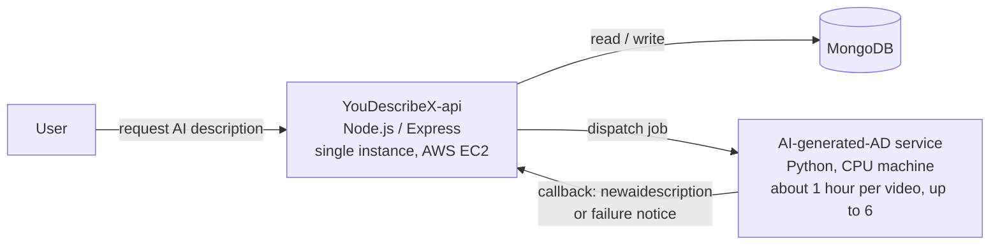

## Overview
> **[Situation](#how-an-ai-job-flows).** YouDescribe's backend sends AI description jobs to a separate AI service, which calls back when a job is done.
>
> **[What went wrong](#the-problems-a-fixed-timeout-and-an-in-memory-queue).** Before sending a new job, the backend checked the jobs already sent to the AI service and marked any job processing for **over 30 mins** as failed, even if the AI service was still running it, since most jobs take longer than that. The job queue also lived in memory, so every deploy lost the jobs waiting in it.
>
> **[The fix](#the-fix-ask-the-ai-service-before-failing-a-job).**
> - **[Status check](#liveness-checked-sweeper).** I added a **`/status` endpoint** to the AI service that returns the jobs it is actually running. Every 10 minutes, a **sweeper** fails a job only if it has run for over 4 hours and `/status` says it isn't running. If `/status` can't be reached, it skips the round and tries again next time.
> - **[Atomic claim](#atomic-claim).** Each failure is claimed with one conditional MongoDB update, so two overlapping sweeps can never email or delete the same job twice.
> - **[Rebuilding the queue](#rebuilding-the-queue-on-startup).** On startup, the backend reads the pending requests from MongoDB and puts them back in the queue.
>
> **Result.** Every job is **handled** correctly: running jobs are never failed by mistake, and queued jobs are picked back up after a restart. Jobs that really fail are caught by the sweeper, and each one triggers exactly one failure email.

## ① How an AI job flows

- A user requests an AI description → the backend saves it as an `AICaptionRequest` with status `pending` → puts it in the **in-memory queue** → dispatches it to the AI service and sets the status to `processing` → the AI service calls back when it finishes
- The concurrency limit comes from `AI_PIPELINE_CONCURRENCY` (existing logic); the dispatcher counts running jobs with `countDocuments('processing')`
- The two systems only had **one-way dispatch plus a callback**, so the backend had no way to know what the AI service was running

---

## ② The problems: a fixed timeout and an in-memory queue
### Failing jobs that were still running
- Old logic: before dispatching a new job, the backend checked the jobs already sent to the AI service and failed any job in `processing` for over 30 minutes. This was a hard-coded timeout; the backend did not know whether the AI service was still running the job
- But most videos take longer than 30 minutes on the CPU machine (about 1 hour typical, up to 6), so there was no callback yet
- The result: the user got a failure email and the record was deleted, **while the AI service kept running the job**, which left the queue state out of sync

### Losing jobs on every deploy
- The queue lived only in memory (`videoProcessingQueue`), so every deploy or restart emptied it
- Requests that were accepted but not yet dispatched were never picked up again, and `pending` jobs were stuck forever

## ③ The fix: ask the AI service before failing a job
### A status endpoint on the AI service
AI-generated-AD repo (2026-07-02)
- Returns the **video_ids the AI service is actually running right now** (read from the real pipeline processes)
- Why it matters: deciding whether a job is dead changes from a fixed cutoff to asking the AI service directly

<h3 id="liveness-checked-sweeper">Liveness-checked sweeper</h3>

api #113, `src/utils/aiRequestSweeper.utils.ts`

**What a sweeper is**: a background cleanup job that runs on a schedule and closes out records that are stuck with nobody handling them
- Not a separate service: it runs inside the backend process, registered at startup (`initializeCronJobs()` in `app.ts`), and restarts with the backend
- Not always running: it wakes up every 10 minutes (cron `'0 */10 * * * *'`), checks, and exits; most runs find nothing to do
- Independent of the callback: a job that calls back becomes `completed`, so the sweeper never sees it. It only handles jobs whose callback never arrives (for example, the AI machine died, so neither the success nor the failure notice was sent)

```
Normal path: dispatch → processing → AI callback → completed (sweeper never sees it)
Safety net:  dispatch → processing → no callback → over 4 hours → sweeper finds it → asks /status → fails it only if not running
```

**Every 10 minutes**, the cron job:
1. Finds records that have been in `processing` for **over 4 hours**
	- 4 hours is only the "start checking" threshold; the rare job that runs longer is protected by the `/status` check
2. Calls the AI service's `/status`
	- If it can't be reached, it **skips** this round (`return`) and retries in 10 minutes. Better to clean up late than to fail a job without confirmation
3. For each record: if it is still in the `active` list, the AI service is still running it, so **leave it alone**
4. If not, do an [atomic claim](#atomic-claim); the winner sends the failure email and deletes the record (so the user can request again)
5. Sends **one summary alert** to admins per run, not one per record

- Also removed the old `recoverStaleProcessing`, **keeping a single cleanup mechanism** so two sets of logic don't fight each other

<h3 id="atomic-claim">Atomic claim</h3>

**The problem it prevents**: the same stuck job being processed twice. For example, one sweep is still running when the next one starts, or, after scaling to multiple instances, several sweepers scan the same collection at once → the user gets two failure emails

**Wrong way: check, then act (a check-then-act race)**
```ts
const rec = await find({ _id, status: 'processing' });  // ① check
if (rec) {
  await update({ _id }, { status: 'failed' });           // ② update
  sendFailureEmail();                                     // ③ email
}
// There is a gap between ① and ②: both sides can see processing at ①, so both run ② and ③
```

**What I wrote: check and update in one step** (`aiRequestSweeper.utils.ts:51`)
```ts
const result = await MongoAICaptionRequestModel.updateOne(
  { _id: rec._id, status: 'processing' },  // condition: still processing
  { $set: { status: 'failed' } },          // update: set to failed
);
if (result.modifiedCount !== 1) continue;  // 0 = someone else already set it to failed, skip
await gpuUtils.notifyAiDescriptionFailure(rec.youtube_id, reason);  // 1 = I won, send email and delete record
```
- Key point: MongoDB's `updateOne` is atomic for a **single document**; checking the condition and updating happen together, with nothing in between
- `modifiedCount` is not stored in the database; it is part of the result `updateOne` returns: how many documents this call actually changed
- This pattern is **compare-and-set (CAS)**, that is, a conditional update, which follows the optimistic concurrency control approach
	- Same idea as the CPU's CAS instruction, SQL's `UPDATE … WHERE status='processing'`, and Redis's `SET NX`: **put the check into the update's condition**
- Benefit: no separate distributed lock is needed
- Trade-off: the status is changed before the email is sent, so if the email fails, the user gets none (at-most-once). Better to miss one email than to send duplicates

<h3 id="rebuilding-the-queue-on-startup">Rebuilding the queue on startup</h3>

api #109, `users.service.ts` → `recoverPendingQueue()`

Runs once after mongoose's `connected` event fires (`app.ts:58`):
1. **Reclaim orphaned jobs**: records in `processing` for over 4 hours are set back to `pending`
	- This assumes a **single-instance deployment**, so these must have been left by a process that already died
	- `processing` records under 4 hours are left alone, since the AI service may still be running them and will call back
2. **Reload**: the reclaimed orphans plus `pending` requests created in the **last 24 hours** go back into the in-memory queue, sorted by creation time. Anything older than 24 hours is treated as abandoned
3. **Start the dispatcher**: it throttles itself by `AI_PIPELINE_CONCURRENCY`

## ④ Verification
**Unit tests**: the sweeper tests cover:
- Still running → skip
- Not running → fail
- `/status` unreachable → skip the whole round
- Atomic claim dedup
- 4-hour threshold

**After release**:
- Before deploying, confirmed both dev and prod had 0 `processing` records, so the release would not fail a batch of old jobs at once
- After #113 was deployed to dev, checked again after about 12 hours (2026-07-04): the container was stable with no restarts, and the sweeper ran every round without errors

## ⑤ Future improvements
| Option | How | Notes |
|---|---|---|
| **Persistent message queue** | Replace the in-memory queue with SQS or RabbitMQ | No jobs lost on deploy or restart, and no need to rebuild the queue on startup |
| **Add a heartbeat** | The AI service regularly reports "I'm alive", used together with `/status` | Detects a dead AI machine faster; today, when the AI machine is down, `/status` can't be reached and the sweeper can only keep skipping |
| **Multiple instances** | Replace the in-memory queue with a shared queue (Redis or SQS) | The assumption that `processing` records at startup must be orphans no longer holds; the atomic claim still works across instances |

---

## Follow-up questions
1. Tell me how you made the connection between the backend and the AI service reliable. (STAR)
	- **Situation**
		- The backend sends AI description jobs to the AI service, which reports back by callback when it finishes
		- Before dispatching a new job, the old logic failed any job in `processing` for over 30 minutes and emailed the user, but most jobs take longer than that, and the backend had no idea whether the AI service was still running it
		- The queue lived only in memory, so every deploy or restart lost the requests waiting in it
	- **Task**
		- Make the backend correctly decide whether a job is really dead, and stop losing jobs on deploy
	- **Action**
		- **`/status`**: added an endpoint to the AI service that returns the jobs it is actually running
		- **Sweeper**: runs every 10 minutes and fails a job only if it is over 4 hours old **and** `/status` confirms it isn't running; skips the whole round if `/status` can't be reached
		- **Atomic claim**: claims each failure with a conditional `updateOne`, so two overlapping sweeps never email or delete the same record twice
		- **Rebuilding the queue**: on startup, reads the `pending` requests from MongoDB and puts them back in the queue
	- **Result**
		- Every job is handled correctly: running jobs are never failed by mistake, and queued jobs are picked back up after a restart
		- Jobs that really fail are caught by the sweeper, and each one triggers exactly one failure email
2. Why add **`/status`**?
	- The backend only had a hard-coded 30-minute timeout and didn't know whether the AI service was still running the job. With `/status`, the decision is based on real information
3. What if **`/status` can't be reached**?
	- Skip the whole round and try again next time. A false failure (the user gets a failure email, the job runs twice) costs far more than cleaning up 10 minutes later
4. What is the **atomic claim**, and why is it needed?
	- It prevents the same record from being processed twice. A conditional `updateOne` combines the check and the update into one step, and `modifiedCount` tells you whether you won (walk through the check-then-act race example)
5. Why not use a **distributed lock**?
	- An atomic update on a single document is enough; no extra infrastructure needed
6. Why was the queue **lost**, and how did you fix it?
	- The queue was in memory, so a restart emptied it. On startup, the backend reclaims orphaned jobs from MongoDB and reloads `pending` requests from the last 24 hours
7. How do you know which `processing` records are **orphans**?
	- Single-instance deployment plus over 4 hours. Anything under the threshold is left alone, since the AI service may still be running it
8. What breaks if you scale to **multiple instances**?
	- The assumption that `processing` records at startup must be orphans no longer holds, and the in-memory queue has to become a shared queue (Redis or SQS)
	- The atomic claim still works across instances
9. What is a better **long-term architecture**?
	- Replace the in-memory queue with a persistent message queue (SQS, RabbitMQ)
	- Add a heartbeat alongside `/status`: the heartbeat tells you the AI service is alive, and `/status` confirms individual jobs
10. What do single-flight (see [Cache Stampede Outage](/posts/cache-stampede-outage/)) and the atomic claim have **in common**?
	- Both **prevent duplicate work under concurrency**. Single-flight shares a Promise in process memory; the atomic claim relies on an atomic database update
	- The first fits a single process; the second works across processes and instances

## References
- [AI-generated-AD PR #3](https://github.com/lanad22/AI-generated-AD/pull/3): `GET /status` reporting the video_ids of running pipelines, merged to `dev` (2026-07-03), promoted to `main` in [#4](https://github.com/lanad22/AI-generated-AD/pull/4)
- [PR #109](https://github.com/youdescribe-sfsu/YouDescribeX-api/pull/109): rebuild the AI processing queue from MongoDB on startup, merged to `dev` (2026-06-18)
- [PR #113](https://github.com/youdescribe-sfsu/YouDescribeX-api/pull/113): `/status`-aware stuck-processing sweeper, merged to `dev` (2026-07-03)
